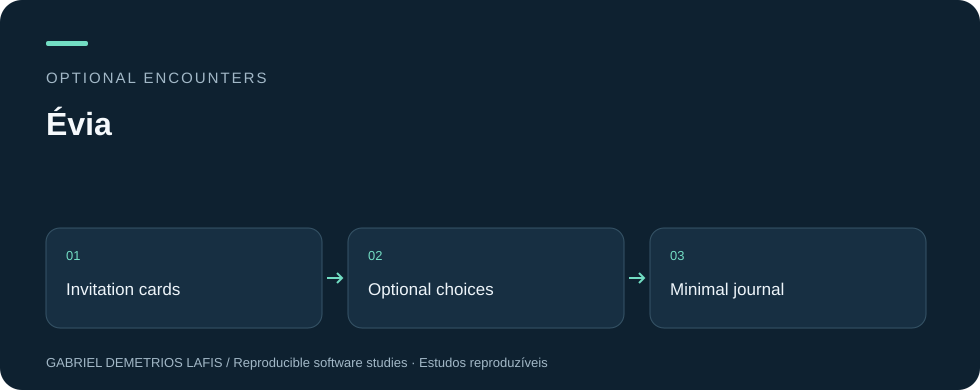
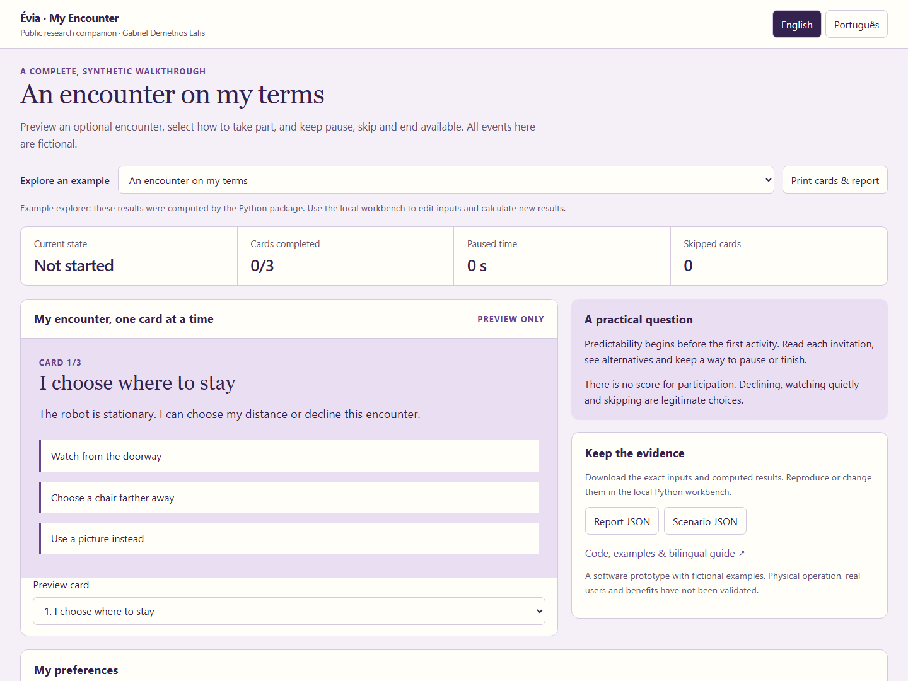
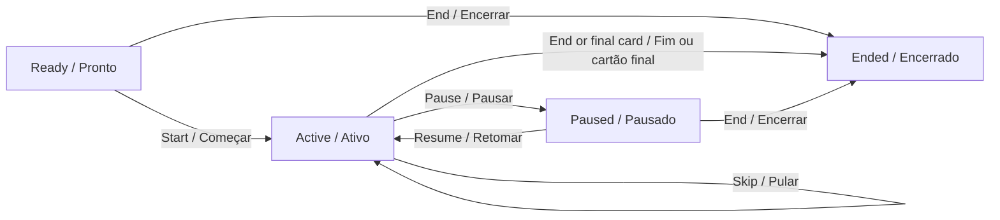

# Évia · My Encounter / Meu Encontro

**Optional encounters · Encontros opcionais**

<p align="center"></p>

[](https://github.com/galafis/evia-inclusive-encounter-kit/actions/workflows/checks.yml)
[English](#english) · [Português](#portugues) · [Guided tour / Visita guiada](docs/SHOWCASE.md) · [Validation / Validação](docs/VALIDATION.md)

> **EN:** What does the record show when a person pauses or declines?<br>
> **PT:** O que o registro mostra quando alguém pausa ou recusa?

## Start here · Comece aqui

| Goal · Objetivo | Where to go · Por onde começar |
| --- | --- |
| Understand a real example · Entender um exemplo concreto | [Walkthrough / Roteiro](docs/DEMO.md) |
| Reproduce and compare · Reproduzir e comparar | [Evidence tour / Visita às evidências](docs/SHOWCASE.md) |
| Inspect the checks · Inspecionar as verificações | [Validation record / Registro de validação](docs/VALIDATION.md) · [CI](https://github.com/galafis/evia-inclusive-encounter-kit/actions/workflows/checks.yml) |
| Explore in the browser · Explorar no navegador | [Public demonstration / Demonstração pública](https://galafis.github.io/evia-inclusive-encounter-kit/) |

**Example result · Resultado do exemplo:** The unstarted example remains unstarted regardless of elapsed time. In the paused example, a fictional 90-second encounter contains 30 seconds paused and 60 seconds active, with two cards completed and one skipped. The declined example ends before starting, with no active time. None of these choices is converted into a performance score.

**Try a comparison · Experimente uma comparação**<br>
**EN:** Compare unstarted, paused and declined examples; inspect active time without assigning a participation score.<br>
**PT:** Compare os exemplos não iniciado, pausado e recusado; inspecione tempo ativo sem pontuar participação.

[](https://galafis.github.io/evia-inclusive-encounter-kit/)

<a id="english"></a>
## English

**The most useful interaction may be the one a person chooses to pause—or decline.**

Prepare a predictable, optional encounter using bilingual invitation cards, explicit alternatives and a participant-controlled sequence. Run the session locally, pause or skip without a score, and export a minimal public event journal through an existing companion package. The kit is a complete public teaching prototype; it does not contain or require the private Évia implementation.

### What works today

- Editable preferences for distance, communication and a quiet place; age-neutral invitation cards in both languages.
- Start, choose, pause, resume, next, skip and end are real validated transitions.
- Next requires an explicit choice. Pause blocks progress; end is terminal and is also available before starting.
- Printable invitation cards and an event-by-event debrief without behavior scores, diagnoses or inferred emotions.
- A public journal adapter emits only session identifier, event identifier, time, kind and outcome.

### A concrete example

The unstarted example remains unstarted regardless of elapsed time. In the paused example, a fictional 90-second encounter contains 30 seconds paused and 60 seconds active, with two cards completed and one skipped. The declined example ends before starting, with no active time. None of these choices is converted into a performance score.

### Run the complete workbench

Python 3.11+ and Git are required. Use a virtual environment. Installation downloads the declared dependencies; analysis runs offline afterwards. Public companion dependencies are fixed to reviewed commits, listed in [UPSTREAM.json](UPSTREAM.json). No account, service key or robot is required.

```bash
git clone https://github.com/galafis/evia-inclusive-encounter-kit.git
cd evia-inclusive-encounter-kit
python -m venv .venv
# Windows PowerShell: .venv\Scripts\Activate.ps1
# macOS / Linux: source .venv/bin/activate
python -m pip install .
python -m encounter_kit serve examples/baseline.json --port 8765
```

Open `http://127.0.0.1:8765`. The local workbench has scenario controls and a full JSON editor. The [hosted explorer](https://galafis.github.io/evia-inclusive-encounter-kit/) shows the three precomputed examples; custom computation requires the local Python workbench. Use Ctrl+C to stop the server.

To create a standalone evidence folder:

```bash
python -m encounter_kit analyze examples/baseline.json --output result-baseline
python -m unittest discover -s tests -v
python scripts/check_examples.py
```

Open `result-baseline/report.html` directly in a browser. It works without a server or network, switches language and prints. The folder also contains the exact scenario, machine-readable report, domain artifacts and a SHA-256 manifest. An existing output folder is refused to preserve earlier results. CLI exit 0 means a valid analysis was written, including findings requiring review; exit 1 means invalid input or an I/O error. Read the result, not just the exit code.

### How the pieces connect



### Relationship to the study programme

The public Évia companions contribute session-state concepts, cue design and minimal journaling. This kit joins them into a usable invitation → choice → debrief experience. A Go2 PRO encounter is an optional future supervised setting involving a stationary robot and a trained operator. The private Évia product is outside this repository and was not accessed to build it.

Related public work: [Inclusive Session Studio](https://github.com/galafis/inclusive-session-studio) · [Session Orchestrator](https://github.com/galafis/evia-session-orchestrator) · [Cue Composer](https://github.com/galafis/evia-cue-composer) · [Local Event Journal](https://github.com/galafis/evia-local-event-journal).

<a id="portugues"></a>
## Português

**A interação mais útil pode ser aquela que a pessoa escolhe pausar — ou recusar.**

Prepare um encontro previsível e opcional com cartões bilíngues de convite, alternativas explícitas e uma sequência controlada pelo participante. Execute localmente, pause ou pule sem pontuação e exporte um diário público mínimo usando um pacote complementar existente. O kit é um protótipo didático público completo; não contém nem exige a implementação privada da Évia.

### O que funciona hoje

- Preferências editáveis para distância, comunicação e local tranquilo; cartões de convite sem infantilização nos dois idiomas.
- Começar, escolher, pausar, retomar, avançar, pular e encerrar são transições reais e validadas.
- Avançar exige uma escolha explícita. A pausa bloqueia o progresso; encerrar é definitivo e também está disponível antes de começar.
- Cartões imprimíveis e discussão evento a evento sem pontuação de comportamento, diagnósticos ou emoções inferidas.
- Um adaptador de diário público emite somente identificador da sessão, identificador do evento, instante, tipo e resultado.

### Um exemplo concreto

O exemplo não iniciado continua assim independentemente do tempo transcorrido. No exemplo com pausa, um encontro fictício de 90 segundos contém 30 segundos pausados e 60 ativos, com dois cartões concluídos e um pulado. O exemplo de recusa termina antes de começar, sem tempo ativo. Nenhuma dessas escolhas é convertida em pontuação de desempenho.

### Executar a bancada completa

São necessários Python 3.11+ e Git. Use um ambiente virtual. A instalação baixa as dependências declaradas; depois disso, a análise funciona offline. Dependências dos companheiros públicos estão fixadas em commits revisados, listados em [UPSTREAM.json](UPSTREAM.json). Não é necessário conta, chave de serviço ou robô.

Execute os comandos de instalação da seção em inglês, abra `http://127.0.0.1:8765` e selecione **Português**. A bancada local possui controles do cenário e editor JSON completo. O [explorador publicado](https://galafis.github.io/evia-inclusive-encounter-kit/) mostra três exemplos pré-calculados; cálculos personalizados exigem a bancada Python local. Ctrl+C encerra o servidor.

```bash
python -m encounter_kit analyze examples/baseline.json --output result-inicial
python -m unittest discover -s tests -v
python scripts/check_examples.py
```

Abra `result-inicial/report.html` diretamente no navegador. Ele funciona sem servidor nem rede, troca de idioma e imprime. A pasta também contém cenário exato, relatório legível por software, artefatos específicos e manifesto SHA-256. Uma pasta de saída existente é recusada para preservar resultados anteriores. O código de saída 0 significa análise válida gravada, inclusive com itens para revisão; 1 indica entrada inválida ou erro de leitura/gravação. Leia o resultado, não apenas o código de saída.

### Relação com o programa de estudos

Os companheiros públicos da Évia contribuem com conceitos de estados da sessão, desenho de sinais e registro mínimo. Este kit os reúne em uma experiência utilizável de convite → escolha → discussão. Um encontro com Go2 PRO é uma possibilidade futura supervisionada, com robô parado e operador treinado. O produto privado Évia está fora deste repositório e não foi acessado para construí-lo.

Trabalhos públicos relacionados: [Inclusive Session Studio](https://github.com/galafis/inclusive-session-studio) · [Session Orchestrator](https://github.com/galafis/evia-session-orchestrator) · [Cue Composer](https://github.com/galafis/evia-cue-composer) · [Local Event Journal](https://github.com/galafis/evia-local-event-journal).

## Documentation / Documentação

| Guide / Guia | Contents / Conteúdo |
| --- | --- |
| [Method / Método](docs/METHOD.md) | Algorithms, assumptions and edge cases / Algoritmos, hipóteses e casos limite |
| [Demonstration / Demonstração](docs/DEMO.md) | A reproducible walkthrough / Uma demonstração reproduzível |
| [Validation / Validação](docs/VALIDATION.md) | Tests and boundaries of the evidence / Testes e limites das evidências |
| [Study plan / Plano de estudo](docs/STUDY_PLAN.md) | Go2 PRO relationship and staged work / Relação com Go2 PRO e trabalho por etapas |
| [Input schema / Esquema de entrada](src/encounter_kit/scenario.schema.json) | Complete versioned contract / Contrato versionado completo |
| [Contributing / Contribuir](CONTRIBUTING.md) | Reproduce and extend / Reproduzir e ampliar |

**Maturity / Maturidade:** functional software MVP for synthetic exercises / MVP de software funcional para exercícios sintéticos. No physical deployment, participant study or institutional endorsement is claimed / Sem alegação de implantação física, estudo com participantes ou endosso institucional.

**Author / Autor:** [Gabriel Demetrios Lafis](https://github.com/galafis) · [gabrieldemetrioslafis@usp.br](mailto:gabrieldemetrioslafis@usp.br) · [MIT License / Licença MIT](LICENSE)
