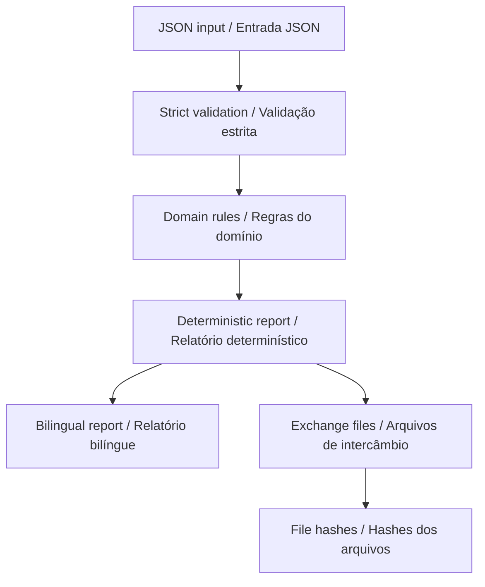

# Method / Método

## English

The input has 1–12 bilingual cards, each with 1–5 explicit alternatives, three public preference descriptions and up to 500 fictional events. `choice` is a zero-based alternative index for `choose` and must be 0 for all other actions. No event is inferred from a preference or from elapsed time.

The sequence begins in `ready`. `start` activates the first card. `choose` records an alternative on the current card. `next` requires a choice, marks that card complete and clears the choice for the next card. `skip` advances without requiring a choice. Leaving the last card ends the session. `pause` is valid only while active; paused sessions permit only resume or end. End is available in every nonterminal state, including before start, and cannot be undone inside that event stream. Editing the scenario creates a new hypothetical replay.

Events are processed in input order. Equal timestamps are allowed and preserve that order; backwards or future events are rejected. Active duration is elapsed time after start minus paused intervals, capped at end. A pause still open at `nowMs` counts through that instant. The interface shows the last computed snapshot, not a running timer. Previewing another card does not change the session card.

The public adapter maps choices/resume to generic observations, start/pause/stop to their public event kinds, and card presentation to a public cue event. Specific alternative text, card identities and preference descriptions are excluded from the journal adapter. The full synthetic scenario and full synthetic timeline remain in the evidence bundle. Retention applies to the derived journal only; it is not deletion of the entire report. The journal uses the pinned public package and an unkeyed digest chain; this detects edits against an independently retained root but does not authenticate a sender.

The sample describes observation of a stationary robot, with no approach or touch required. It is a discussion aid for inclusive education, including exploration with autistic children and adults after appropriate co-design. It provides no clinical assessment, therapy claim, suitability score or guarantee of comfort.

### Contract and evidence

The [schema](../src/encounter_kit/scenario.schema.json) is strict: extra fields, non-finite numbers, duplicate JSON keys, missing translations and inputs above 1 MiB are rejected. Domain checks validate references and transitions after structural validation. `source` must be `synthetic`; this release intentionally does not accept participant or physical-run records. Inputs are never modified in place.

`analyze(data)` returns a deterministic JSON-compatible report with `schemaVersion`, `engineVersion`, `scenarioId`, `source`, `inputSha256`, bilingual metrics/sections/cards and domain results. `artifacts(data, report)` supplies independent exchange files. The input fingerprint hashes UTF-8 JSON with sorted keys and compact separators; it identifies exact input content, not its truth or origin. The bundle manifest hashes file bytes. Neither hash mechanism is a digital signature.

The loopback server binds only `127.0.0.1`, validates Host/Origin and accepts JSON requests with a bounded body. It serves no arbitrary files and writes no session database. The standalone report embeds data with escaped script boundaries and renders values as text. Language choice affects presentation only. A successful analysis never changes the schema or input values.

## Português

A entrada possui 1–12 cartões bilíngues, cada um com 1–5 alternativas explícitas, três descrições públicas de preferências e até 500 eventos fictícios. `choice` é o índice da alternativa a partir de zero para `choose` e deve ser 0 nas demais ações. Nenhum evento é inferido de uma preferência ou do tempo transcorrido.

A sequência começa em `ready`. `start` ativa o primeiro cartão. `choose` registra uma alternativa no cartão atual. `next` exige escolha, marca o cartão como concluído e apaga a escolha para o próximo. `skip` avança sem exigir escolha. Sair do último cartão encerra a sessão. `pause` só é válido durante atividade; sessões pausadas permitem apenas retomar ou encerrar. Encerrar está disponível em qualquer estado não terminal, inclusive antes de começar, e não pode ser desfeito nesse fluxo de eventos. Editar o cenário cria uma nova reprodução hipotética.

Eventos são processados na ordem da entrada. Instantes iguais são aceitos e preservam a ordem; eventos anteriores ou futuros são rejeitados. A duração ativa é o tempo após o início menos os intervalos pausados, limitado ao encerramento. Uma pausa aberta em `nowMs` conta até esse instante. A interface mostra o último cálculo, não um cronômetro contínuo. Visualizar outro cartão não altera o cartão da sessão.

O adaptador público transforma escolhas/retomadas em observações genéricas, início/pausa/fim nos tipos públicos correspondentes e apresentação de cartão em evento público de sinal. Texto específico da alternativa, identidades dos cartões e descrições de preferências ficam fora do adaptador do diário. O cenário sintético completo e a linha do tempo sintética completa permanecem no pacote. A retenção vale somente para o diário derivado; não apaga todo o relatório. O diário usa o pacote público fixado e uma cadeia de hashes sem chave; detecta alterações contra uma raiz guardada independentemente, mas não autentica o remetente.

O exemplo descreve observação de um robô parado, sem exigir aproximação ou toque. É um apoio à discussão para educação inclusiva, incluindo exploração com crianças e adultos autistas após desenvolvimento participativo adequado. Não oferece avaliação clínica, alegação terapêutica, pontuação de adequação ou garantia de conforto.

### Contrato e evidências

O [esquema](../src/encounter_kit/scenario.schema.json) é estrito: campos extras, números não finitos, chaves JSON duplicadas, traduções ausentes e entradas acima de 1 MiB são rejeitados. Verificações de domínio validam referências e transições após a validação estrutural. `source` deve ser `synthetic`; esta versão intencionalmente não aceita registros de participantes ou execuções físicas. A entrada nunca é alterada diretamente.

`analyze(data)` retorna um relatório determinístico compatível com JSON, contendo `schemaVersion`, `engineVersion`, `scenarioId`, `source`, `inputSha256`, métricas/seções/cartões bilíngues e resultados do domínio. `artifacts(data, report)` fornece arquivos independentes de intercâmbio. A impressão digital da entrada calcula o hash do JSON UTF-8 com chaves ordenadas e separadores compactos; identifica o conteúdo exato, não sua veracidade ou origem. O manifesto do pacote calcula hashes dos bytes dos arquivos. Nenhum desses mecanismos é uma assinatura digital.

O servidor local escuta somente em `127.0.0.1`, valida Host/Origin e aceita requisições JSON com tamanho limitado. Não disponibiliza arquivos arbitrários nem grava banco de sessões. O relatório independente incorpora dados com proteção dos limites de scripts e apresenta valores como texto. O idioma afeta somente a apresentação. Uma análise bem-sucedida nunca altera o esquema nem os valores de entrada.

[Back / Voltar](../README.md)
